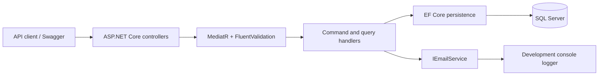
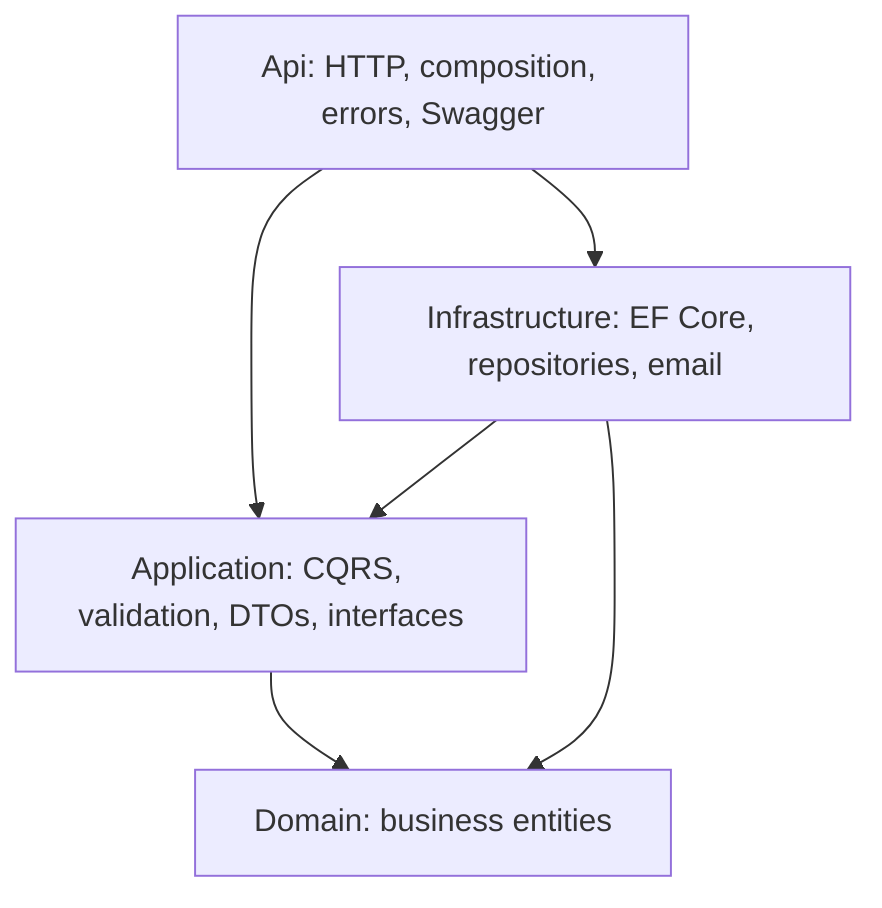

# Customer Statement API

**ASP.NET Core 8 · Clean Architecture · CQRS · MediatR · FluentValidation · EF Core · SQL Server**

A focused backend project for generating monthly customer account statements and retrieving statement history. It demonstrates how financial business rules, request validation, persistence, and delivery concerns can be separated in a maintainable .NET application.

## What it solves

Customer transactions need to become a consistent monthly statement: an opening balance, the month's debit and credit movements, and a closing balance. This API generates that statement, associates the matching transactions, and exposes the customer's statement history with optional month filters.

## Key features

- Generate a monthly statement and carry forward the most recent earlier closing balance, or start at zero.
- Calculate `closing balance = opening balance + credits - debits` using decimal amounts.
- Return the existing statement ID for a repeated customer/month request.
- Enforce one statement per customer/month with a unique database index.
- Retrieve statements with customer information and transaction details, ordered by month.
- Validate commands and queries through a shared MediatR pipeline.
- Return structured validation and missing-resource errors.
- Expose Swagger/OpenAPI documentation with request and response examples.
- Route delivery through `IEmailService`; the included implementation logs the message for local development.

## Architecture



The request flow above shows runtime collaboration. Project dependencies keep infrastructure implementations outside the application layer:



| Project | Responsibility |
| --- | --- |
| `CustomerStatement.Api` | HTTP endpoints, dependency injection, Swagger, exception handling |
| `CustomerStatement.Application` | Commands, queries, handlers, validators, DTOs, persistence/delivery contracts |
| `CustomerStatement.Domain` | `Customer`, `AccountStatement`, `StatementTransaction` |
| `CustomerStatement.Infrastructure` | SQL Server DbContext, migrations, statement repository, development email service |

## Technologies

C# and .NET 8, ASP.NET Core Web API, EF Core 8 with SQL Server, MediatR, FluentValidation, and Swashbuckle/OpenAPI. Package versions are recorded in each project's `.csproj` file.

## API endpoints

| Method | Route | Purpose |
| --- | --- | --- |
| `GET` | `/api/Statements?customerId={id}&fromMonth={date}&toMonth={date}` | Retrieve statements; month filters are optional and inclusive |
| `POST` | `/api/Statements/generate` | Generate a monthly statement or return the existing statement ID |

### Generate a statement

```http
POST /api/Statements/generate
Content-Type: application/json
```

```json
{
  "customerId": 1,
  "statementMonth": "2026-06-01"
}
```

Example `200 OK` response; the ID depends on your local database:

```json
{
  "statementId": 6,
  "message": "Monthly statement generated successfully."
}
```

### Retrieve statement history

```http
GET /api/Statements?customerId=1&fromMonth=2026-01-01&toMonth=2026-06-01
```

The response is an array containing statement IDs, customer details, statement months, opening/closing balances, generation timestamps, and transaction details. A query with no matching statements returns an empty array.

### Validation and errors

- `customerId` must be positive.
- Statement months and supplied month filters must use the first day of the month.
- `fromMonth` must be earlier than or equal to `toMonth`.
- Validation failures return `400` with `ValidationProblemDetails`.
- Generating a statement for a missing customer returns `404` with `ProblemDetails`.

## Run locally

Prerequisites: **.NET 8 SDK**, a local SQL Server/SQL Server Express instance, and the EF Core CLI 8.x.

```powershell
git clone https://github.com/HamzaDee/CustomerStatement.git
cd CustomerStatement
dotnet restore
```

Configure your local connection using the project's existing User Secrets configuration:

```powershell
dotnet user-secrets set "ConnectionStrings:DefaultConnection" "Server=(localdb)\MSSQLLocalDB;Database=CustomerStatementDb;Trusted_Connection=True;TrustServerCertificate=True" --project CustomerStatement.Api
```

This example uses Windows LocalDB for local development. Replace the server/authentication settings when using another SQL Server instance.

```powershell
# Only if dotnet-ef is not installed:
dotnet tool install --global dotnet-ef --version "8.*"

dotnet ef database update --project CustomerStatement.Infrastructure --startup-project CustomerStatement.Api
dotnet build
dotnet run --project CustomerStatement.Api --launch-profile https
```

Open **https://localhost:7084/swagger**. This launch profile runs in Development, where Swagger is enabled. If needed, trust your local development certificate with `dotnet dev-certs https --trust`.

Migrations create the schema; they do not seed customers or transactions. Add synthetic records to your local database before generating a statement. Customer and transaction creation endpoints are outside the current scope.

## Architecture decisions

| Decision | Reason and tradeoff |
| --- | --- |
| Separate commands and queries | Generation rules and read projections evolve independently; both currently use one database. |
| MediatR validation behavior | Keep validation consistent without repeating it in controllers. |
| Persistence behind application contracts | Infrastructure implements the contracts; the command-side DbContext interface still exposes EF Core types. |
| No-tracking statement queries | Load related customer/transaction data without tracking changes. |
| Decimal amounts and a unique customer/month index | Preserve currency precision and enforce the monthly boundary in the database. |
| Delivery abstraction | Replace console logging with an email provider without embedding provider details in handlers. |

## Current boundaries

The email service **logs messages; it does not send SMTP email**. Repeated generation returns the existing ID without regenerating or resending the statement. Persistence completes before delivery, so a production workflow would benefit from an outbox and retries. Concurrent insert conflicts are protected by the unique index but do not have a dedicated API response mapping. Authentication, automated tests, and transaction ingestion are areas for further development.

---

[Hamza Naghnaghieh](https://github.com/HamzaDee) · **Full-Stack Software Engineer | 7 years**
